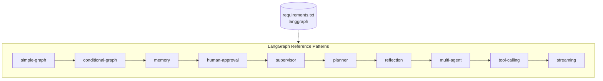

# langgraph

> Teach LangGraph through a series of self-contained graph examples.

This repository is a **reference collection** of LangGraph patterns. Each folder is an
independently runnable example that demonstrates one core concept: from a minimal linear
state graph up through conditional routing, memory/persistence, human-in-the-loop,
supervisor/planner/reflection orchestration, multi-agent collaboration, tool calling, and
streaming.

> Status: **working.** All ten patterns are implemented and each `graph.py` runs end to end.
> Every example is fully offline and deterministic — no model provider, no API keys, no network.
> A pytest suite covers every pattern and runs in CI on each push.

## Architecture



Each pattern builds on concepts introduced by the ones before it, but every folder can be
studied and run on its own.

## Folder Structure

```
langgraph/
├── README.md              # this index
├── requirements.txt       # shared dependencies (text manifest only)
├── LICENSE                # MIT
├── .gitignore
├── simple-graph/          # minimal linear StateGraph
│   ├── README.md
│   └── graph.py
├── conditional-graph/     # conditional edges / routing
│   ├── README.md
│   └── graph.py
├── memory/                # checkpointers & persistence
│   ├── README.md
│   └── graph.py
├── human-approval/        # human-in-the-loop interrupts
│   ├── README.md
│   └── graph.py
├── supervisor/            # supervisor routing to workers
│   ├── README.md
│   └── graph.py
├── planner/               # plan-and-execute
│   ├── README.md
│   └── graph.py
├── reflection/            # generate → critique → revise loop
│   ├── README.md
│   └── graph.py
├── multi-agent/           # collaborating agents
│   ├── README.md
│   └── graph.py
├── tool-calling/          # bind tools / ToolNode
│   ├── README.md
│   └── graph.py
└── streaming/             # streaming tokens & events
    ├── README.md
    └── graph.py
```

## Installation Guide

No Docker is required for this reference collection.

```bash
# 1. Clone
git clone https://github.com/ranjan-del/langgraph.git
cd langgraph

# 2. Create and activate a virtual environment
python -m venv .venv
source .venv/bin/activate        # Windows: .venv\Scripts\activate

# 3. Install dependencies
pip install -r requirements.txt

# 4. Run any pattern (no API keys required)
python simple-graph/graph.py

# 5. Run the test suite
pytest -q
```

No API keys are required — every pattern runs fully offline and deterministically.

## Features

- **simple-graph** — the smallest possible `StateGraph`: one node, one edge.
- **conditional-graph** — branch execution with conditional edges and a router function.
- **memory** — persist state across turns with a checkpointer (thread-scoped memory).
- **human-approval** — pause a graph with an interrupt for human review before continuing.
- **supervisor** — a supervisor node that delegates to specialized worker nodes.
- **planner** — plan-and-execute: draft a multi-step plan, then execute each step.
- **reflection** — generate an answer, critique it, and revise in a loop.
- **multi-agent** — multiple agents collaborating and handing off to one another.
- **tool-calling** — bind tools to a model and route through a `ToolNode`.
- **streaming** — stream tokens and intermediate graph events to the caller.

## Testing

Every pattern has at least one deterministic test that runs its graph and asserts
on the output. Run the full suite from the repo root:

```bash
pytest -q
```

Continuous integration runs the same suite on Python 3.11 and 3.12 via
[`.github/workflows/ci.yml`](./.github/workflows/ci.yml) on every push and pull request.

## Screenshots

_Not captured (headless build)._

## Demo GIF

_Not captured (headless build)._

## API Documentation

This is a library/reference repository rather than a service; it exposes no HTTP API.
The public entry point of each pattern is its compiled graph.

| Pattern | Entry point | Description |
| --- | --- | --- |
| simple-graph | `graph.py:build_graph()` | Minimal linear state graph |
| conditional-graph | `graph.py:build_graph()` | Conditional routing |
| memory | `graph.py:build_graph()` | Persistent state via checkpointer |
| human-approval | `graph.py:build_graph()` | Human-in-the-loop interrupt |
| supervisor | `graph.py:build_graph()` | Supervisor / worker delegation |
| planner | `graph.py:build_graph()` | Plan-and-execute |
| reflection | `graph.py:build_graph()` | Generate / critique / revise |
| multi-agent | `graph.py:build_graph()` | Collaborating agents |
| tool-calling | `graph.py:build_graph()` | Model + ToolNode |
| streaming | `graph.py:build_graph()` | Streaming events |

Each pattern folder also has its own `README.md` describing that pattern's architecture,
flow, and explanation.

## Future Improvements

- Add optional "live" variants that swap the deterministic stand-ins for a real
  model provider (loaded from `.env`) while keeping the offline default.
- Add a notebook variant for each pattern for interactive exploration.
- Render each pattern's flow diagram as an image and embed it in the folder README.
- Expand the tool-calling example with additional tools and multi-step reasoning.

## License

Released under the [MIT License](./LICENSE).
