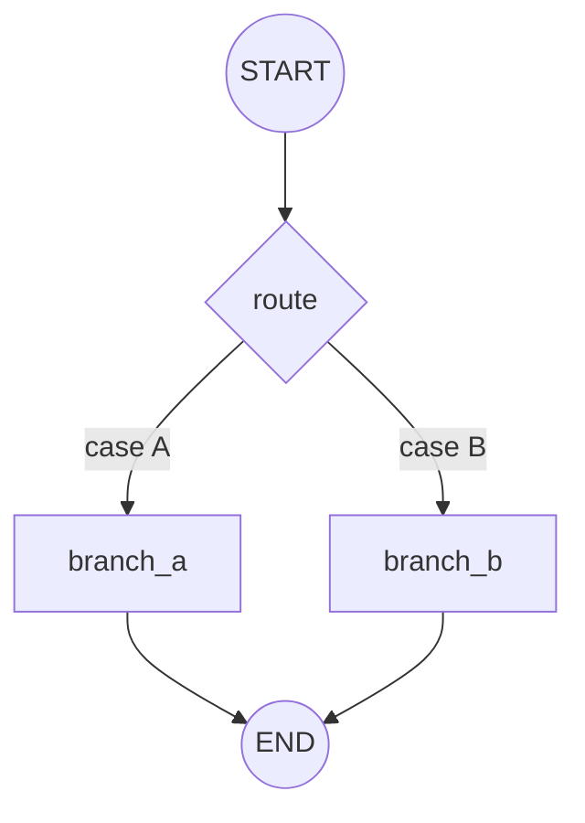

# conditional-graph

Introduces **conditional edges**: a router function inspects the state and decides which node
runs next. This is how LangGraph expresses branching and looping.

## Architecture

- A `State` carries the value the router keys off of.
- Two or more branch nodes handle the different cases.
- A `route` function returns the name of the next node.
- `add_conditional_edges` maps router outputs to node names.

## Flow Diagram

## Explanation

Static edges always run the same next node. Conditional edges let a plain Python function
decide at runtime, based on the current state, where control flows. The router returns a
string (or list of strings) that LangGraph maps to node names. The same mechanism, when a
router can point back to an earlier node, is what creates loops — the basis for the
reflection and agent patterns later in this collection.
