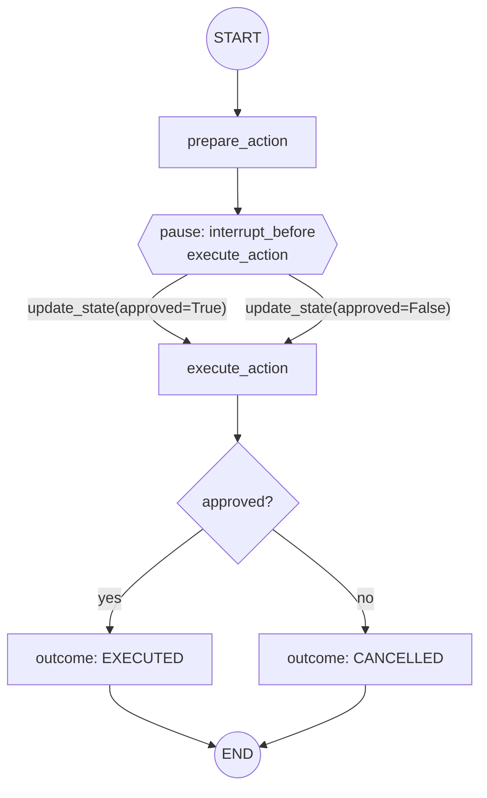

# human-approval

Human-in-the-loop: the graph **interrupts** before a sensitive node so a person can review,
edit, or approve before execution continues.

## Architecture

- Compiled with a checkpointer (required to pause and resume).
- `interrupt_before` (or an `interrupt()` call) halts execution at a node.
- The caller inspects state, then resumes the run with the same `thread_id`.
- On resume, the pending node runs with any human edits applied.

## Flow Diagram

Note that the pause is not a graph edge. The only edges are
`START -> prepare_action -> execute_action -> END`; the diamond is where the compiled graph
hands control back to the caller because of `interrupt_before=["execute_action"]`.

## Explanation

Some actions should not run autonomously. LangGraph supports this by pausing a run at a
designated point and returning control to the caller. Because state is checkpointed, the run
can sit paused indefinitely; when resumed with the same thread id, it picks up exactly where
it left off, optionally with human-modified state. This turns an autonomous graph into a
supervised one without rewriting its logic.
