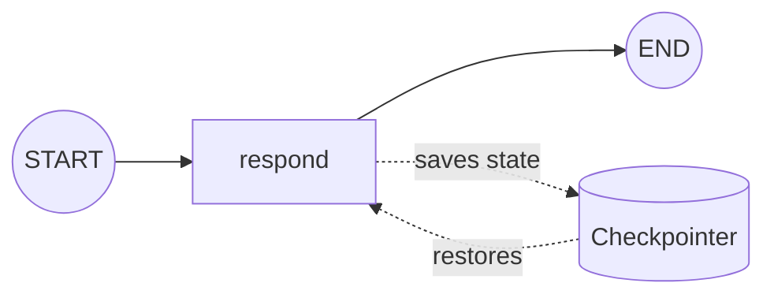

# memory

Adds **persistence** with a checkpointer so state survives across invocations. A `thread_id`
scopes the memory, letting the same graph hold separate conversations.

## Architecture

- A checkpointer (e.g. `MemorySaver`) stores state snapshots per thread.
- The graph is compiled with `checkpointer=...`.
- Each invocation passes a `config` containing a `thread_id`.
- Re-invoking with the same `thread_id` resumes from saved state.

## Flow Diagram

## Explanation

Without a checkpointer a graph is stateless between calls. Attaching one makes LangGraph
persist a snapshot of the state after every step, keyed by the `thread_id` you supply in the
run config. The next call with that same id restores the snapshot, so the graph "remembers"
prior turns. This is the foundation of conversational memory and of the human-in-the-loop
pattern, where a run must pause and later resume exactly where it stopped.
