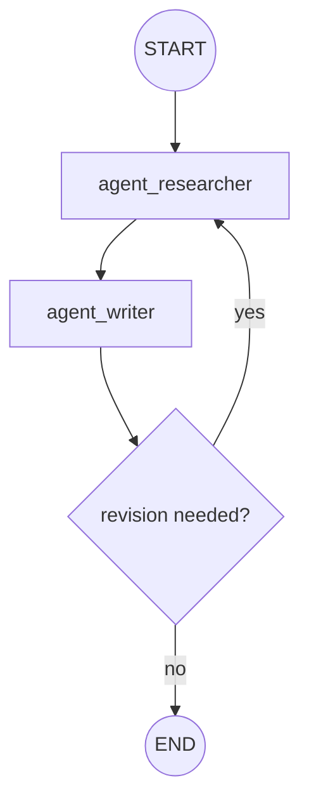

# multi-agent

Multiple specialized **agents collaborate**, handing off control and sharing state to solve a
task no single agent owns end to end.

## Architecture

- Each agent is a node (often itself a small sub-graph) with a distinct role.
- Agents communicate through shared state (e.g. an appended message list).
- Handoff edges (static or conditional) pass control between agents.

## Flow Diagram

## Explanation

Where the supervisor pattern centralizes routing, a multi-agent graph distributes it: agents
hand off directly to one another, each contributing its specialty (research, writing, review,
and so on) and reading the shared conversation state. Handoffs can be fixed pipelines or
conditional, allowing agents to send work back for revision. This models collaborative
workflows and is the basis for more elaborate agent networks.
