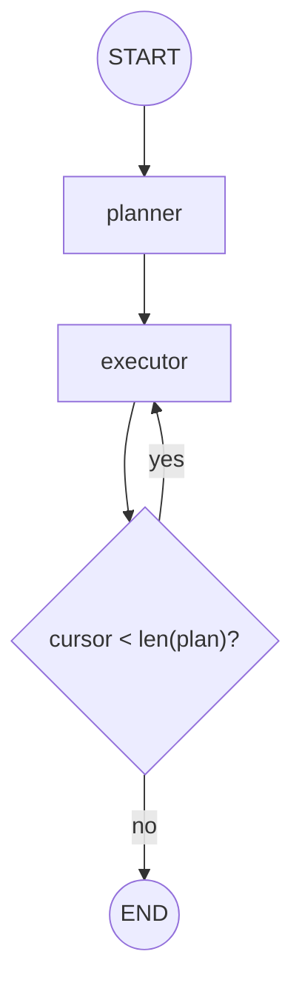

# planner

**Plan-and-execute**: first draft a multi-step plan, then execute the steps one at a time,
re-planning if needed. Separates "what to do" from "doing it".

## Architecture

- A planner node produces an ordered list of steps.
- An executor node runs the current step and records the result.
- A router (`route_after_step`) loops back to the executor until the plan is exhausted.

## Flow Diagram

The diagram matches the code exactly. Re-planning (a `C -->|replan| P` edge) is the natural
next extension and is discussed below, but it is deliberately not wired up here so the base
plan-and-execute loop stays readable.

## Explanation

Complex tasks benefit from an explicit plan. The planner decomposes the objective into
discrete steps up front; the executor then works through them, keeping the plan and the
gathered results in state. If a step reveals the plan was wrong, the router can send control
back to the planner to revise. This structure, deliberate planning followed by grounded
execution, tends to be more reliable than asking a single node to do everything at once.
