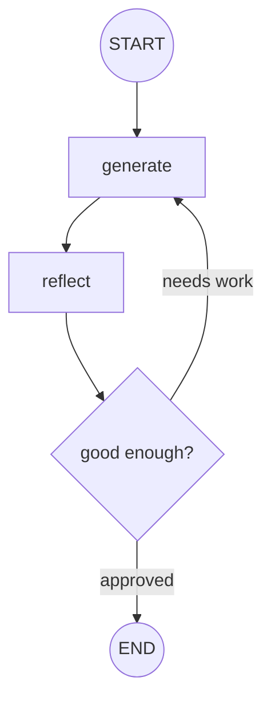

# reflection

**Generate → critique → revise.** The graph produces a draft, critiques its own output, and
loops to improve it until the critique is satisfied or a limit is reached.

## Architecture

- A generate node produces (or revises) a draft.
- A reflect node critiques the draft against the goal.
- A router loops back to generate while the critique demands changes, up to a max iteration
  count.

## Flow Diagram

## Explanation

Reflection improves quality by making self-critique an explicit step. Rather than trusting a
single pass, the graph loops: generate a draft, critique it, feed the critique back, and
regenerate. A bounded loop (max iterations) prevents runaway cycles. This is a simple but
powerful pattern for tasks like writing, coding, or reasoning where a second look reliably
catches mistakes the first pass misses.
