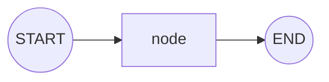

# simple-graph

The smallest possible LangGraph: a single node wired between `START` and `END`. This is the
"hello world" of `StateGraph` and the foundation every other pattern builds on.

## Architecture

- A typed `State` (a `TypedDict`) carries data through the graph.
- One node function reads the state and returns a partial update.
- Edges connect `START → node → END`.
- `graph.compile()` produces a runnable you invoke with an initial state.

## Flow Diagram

## Explanation

A LangGraph program is a directed graph whose nodes are plain functions. Each node receives
the current state and returns a dictionary that is merged back into it. The `simple-graph`
example strips this to the essentials so the mechanics (state schema, node, edges, compile,
invoke) are visible without any branching or model calls. Once this clicks, conditional
routing and every richer pattern is just more nodes and edges.
