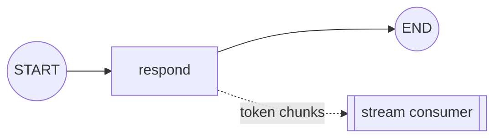

# streaming

Stream a graph's output incrementally — token by token and/or step by step — instead of
waiting for the final result. Essential for responsive UIs.

## Architecture

- The graph is invoked with `graph.stream(...)` (or `astream`).
- A `stream_mode` selects what is emitted: `values`, `updates`, or `messages` (tokens).
- The caller iterates over the yielded chunks and renders them as they arrive.

## Flow Diagram

## Explanation

Streaming changes how you consume a graph, not how you build it. Rather than a single blocking
`invoke`, you call `stream` and receive a sequence of chunks: full state snapshots
(`values`), per-node deltas (`updates`), or individual LLM tokens (`messages`). The caller
renders each chunk as it arrives, giving users immediate feedback. The same compiled graph
supports both invoke and stream, so streaming is purely a consumption concern layered on top
of any pattern in this collection.
