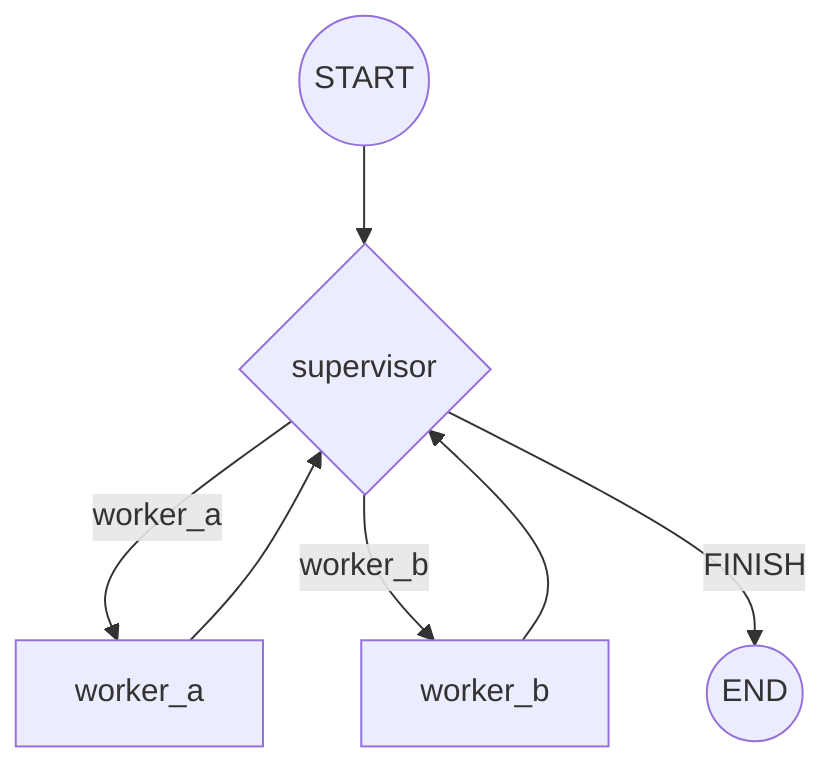

# supervisor

A **supervisor** node routes work to specialized worker nodes and decides when the task is
done. This is the classic orchestrator pattern for coordinating multiple capabilities.

## Architecture

- A supervisor node inspects state and picks the next worker (or `FINISH`).
- Each worker node handles one capability and returns to the supervisor.
- Conditional edges from the supervisor implement the routing decision.

## Flow Diagram

## Explanation

The supervisor pattern centralizes control: instead of workers deciding among themselves who
goes next, one node owns the routing logic. It reads the accumulated state, chooses the most
relevant worker, and loops back after each worker finishes, until it decides the objective is
met and routes to `END`. This keeps individual workers simple and makes the overall
coordination policy easy to reason about and swap out.
