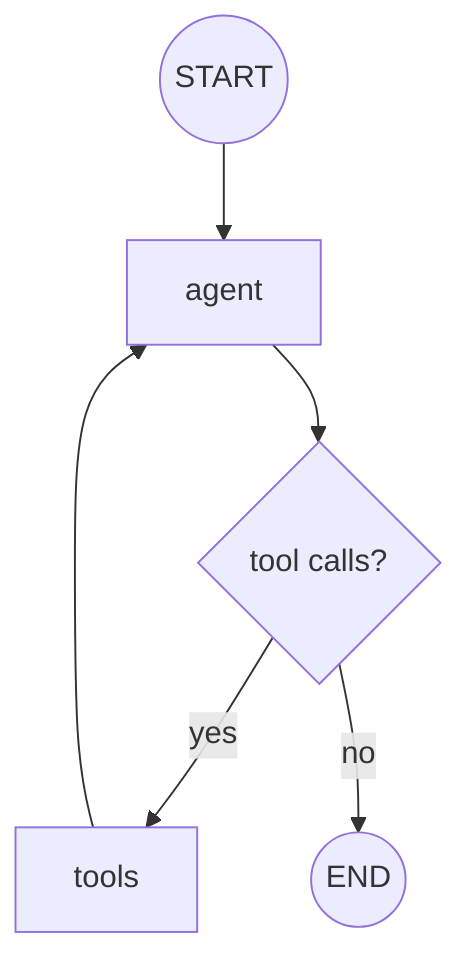

# tool-calling

Bind **tools** to a model and route tool calls through a `ToolNode`. This is the core ReAct-
style loop: the model decides to call a tool, the tool runs, and the result feeds back in.

## Architecture

- Tools are declared with the `@tool` decorator (or as functions).
- The model is bound to the tools so it can emit tool calls.
- An agent node calls the model; a `ToolNode` executes any requested tools.
- A conditional edge loops back to the agent while tool calls remain.

## Flow Diagram

## Explanation

Tool calling lets a model reach beyond text generation to fetch data or take actions. The
model, bound to a set of tools, may respond with structured tool calls instead of a final
answer. A `ToolNode` executes those calls and appends the results to the message state; the
agent node then runs again with the new information. The loop continues until the model
answers without requesting more tools — the essence of the ReAct pattern.
